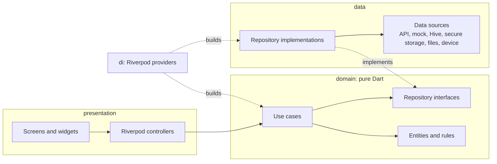

# C360 Field

Face-verified site attendance for Sobha construction technicians. A technician checks in and out with a selfie, only while connected to one of their project's registered Wi-Fi access points. Every record is written to the phone before anything goes over the network, so a dropped connection never loses a check-in.

## Setup

Requirements: Flutter stable (built with 3.47, Dart 3.11), Android SDK, a physical Android phone for the camera and Wi-Fi checks.

```bash
flutter pub get
flutter run                      # mock API, the default
flutter test                     # unit + widget tests
flutter analyze                  # lint clean
flutter build apk --debug        # debug-signed APK in build/app/outputs/flutter-apk/
```

Configuration is one build parameter. Pass the API base URL with `API_BASE_URL` and the app uses the real API; leave it out and it runs on the built-in mock API. Other settings (history window, selfie size limit, version) are defaults in `lib/core/config/app_config.dart`.

```bash
flutter run                                                                  # mock API
flutter run --dart-define=API_BASE_URL=https://api.example.com/v1            # real API
flutter build apk --release --dart-define=API_BASE_URL=https://api.example.com/v1
```

### Mock API

Without `API_BASE_URL` the API is swapped for the mock data sources, a local fake that follows the API contract exactly: the same JSON shapes, status codes and error codes, `clientId` idempotency, and sequence rules. It persists in Hive, so history survives restarts.

- Any Employee ID signs in. The password `wrong` returns `401 INVALID_CREDENTIALS`.
- **Profile → Mock server** has switches for the test conditions:
  - **Face matches**: off makes the server return `422 FACE_NOT_MATCHED`.
  - **Register current Wi-Fi**: adds the BSSID the phone is on to the project's list, so the Wi-Fi check passes on your own router. Turn it off to see the Wi-Fi failure screen.
  - **Simulate no internet**: stay on Wi-Fi but make the server unreachable. This is the real site situation: on site Wi-Fi, no uplink.
  - **Simulate server error**: return `503` to show retry with exponential backoff on the Sync screen.

### Local HTTP mock (json-server)

`tools/mock-api/` is a json-server mock of the same contract, served over real HTTP. Point `API_BASE_URL` at it and the app runs on the production `*ApiDataSource` classes (Dio, multipart upload, bearer token, error mapping) with no code changes. This shows the real API is a drop-in swap behind the repository interfaces.

```bash
cd tools/mock-api
npm install
npm start -- --bssid <your-router-bssid>       # prints the flutter run command for each LAN IP
npm run reset                                   # wipe data back to db.seed.json
```

```bash
flutter run --dart-define=API_BASE_URL=http://<pc-lan-ip>:3000/api/v1      # phone on the same Wi-Fi as the PC
flutter run --dart-define=API_BASE_URL=http://10.0.2.2:3000/api/v1         # Android emulator
```

| Endpoint | Behaviour |
|---|---|
| `POST /auth/login` | Any Employee ID; password `wrong` returns `401 INVALID_CREDENTIALS`. Returns `{token, expiresIn}` (8 h). |
| `POST /auth/microsoft` | Any `idToken` signs in as the seeded employee. |
| `GET /me` | Profile with project, shift and `wifiBssids`. Missing or expired token returns `401`. |
| `POST /attendance` | Multipart `clientId`, `type`, `capturedAt`, `bssid`, `selfie`. `201 {id, status: VERIFIED}`; same `clientId` again returns `200` with `duplicate: true`; `403 NOT_ON_SITE_NETWORK`, `422 MISSING_PHOTO / NO_FACE_FOUND / FACE_NOT_MATCHED`, `409 SEQUENCE_ERROR`. Selfies are saved to `uploads/`. |
| `GET /attendance?from&to` | `{items: [{id, type, capturedAt, status}]}` for the date range; five past working days are seeded on first call. |

- Data lives in `tools/mock-api/db.json` (created from `db.seed.json`) and can be browsed at `http://localhost:3000/db/attendance`.
- The Wi-Fi check compares the phone's BSSID with `wifiBssids` from `/me`, so register your router: pass `--bssid`, set `SITE_BSSIDS=aa:bb:...,cc:dd:...`, or `POST /api/v1/_mock/bssids {"bssid": "..."}`.
- Test switches: `PATCH /api/v1/_mock/settings` with `{"faceMatches": false}`, `{"serverError": true}` (every call returns `503`) or `{"latencyMs": 3000}`. For no internet, stop the server or keep the phone on Wi-Fi and unplug the PC.
- Debug builds allow cleartext HTTP (`android/app/src/debug/AndroidManifest.xml`) so the phone can reach `http://<pc-ip>`. Release builds stay HTTPS only.

### Demo script (screen recording)

1. **Online path:** sign in, then Check in → Wi-Fi check passes → camera (shutter enables only with exactly one face) → *Checked in*.
2. **Offline path:** switch on *Simulate no internet* (or use airplane mode with Wi-Fi on). Check out → *Saved offline*. A badge appears on the Sync tab and a banner on Home. Kill the app and reopen it: the record is still queued. Switch the simulation off and the app syncs automatically with a "Synced 1 record" toast.
3. **Failure states:**
   - Wrong password.
   - Wi-Fi not registered (turn off *Register current Wi-Fi*).
   - Wi-Fi off.
   - Location permission denied.
   - No face or two faces in frame (shutter stays disabled).
   - Face didn't match (turn off *Face matches*).
   - Server 503 with retry countdown (turn on *Simulate server error*, then queue a record).

## Architecture

Feature-first clean architecture. Shared infrastructure lives in `core/`. Each feature is split into four parts, and dependencies point inwards only: `presentation` → `domain` ← `data`, wired together by `di`.



```
lib/
  main.dart                       opens storage, picks the config, starts the app
  app.dart                        MaterialApp, theme, router
  core/
    config/app_config.dart        base URL from --dart-define (empty = mock API), app limits
    di/core_providers.dart        config, clock, Dio, connectivity, preferences, mock settings
    error/                        AppException (network, unauthorized, rejected, server), error codes
    network/                      Dio setup and HTTP → AppException mapping, ConnectivityService
    storage/                      Hive boxes, preferences, secure token storage
    mock/                         mock server state and simulated connectivity (mock builds)
    routing/                      routes, auth redirect, bottom navigation shell
    theme/                        Sobha Gold palettes, light and dark themes, theme mode
    utils/                        formatters, BSSID normalisation
    widgets/                      shared widgets
  features/
    auth/                         sign-in, Microsoft stub, session restore, profile
    site_check/                   Wi-Fi BSSID reading and the site Wi-Fi rule
    attendance/                   records, capture, history, check-in flow, home
    sync/                         offline queue sync with retry and backoff
```

Each feature has the same shape:

```
features/attendance/
  domain/
    entities/                     AttendanceRecord, DaySummary, HistoryResult
    repositories/                 AttendanceRepository (interface)
    rules/                        attendance_rules.dart: today's state, worked hours, merge, grouping
    usecases/                     CaptureAttendance, LoadHistory, WatchRecords, GetRecord, DiscardRecord, ...
  data/
    models/                       JSON mapping
    datasources/                  API (Dio), mock, Hive queue, Hive history cache, selfie files, face detection
    repositories/                 AttendanceRepositoryImpl
  di/attendance_providers.dart    builds data sources, the repository and the use cases
  presentation/
    providers/                    controllers and view state
    screens/                      home, check-in flow, history
    widgets/                      attendance card, week chart, selfie camera, ...
```

- **Domain** is pure Dart: no Flutter, Dio, Hive, `dart:io` or HTTP status codes. Failures are `AppException` types such as network, unauthorized, rejected and server. Everything is unit tested with in-memory fakes.
- **Data** is the only layer that knows about Dio, Hive, secure storage, files or plugins. It maps HTTP status codes into domain failures (`httpFailure` in `core/network/api_client.dart`).
- **Presentation** calls use cases only. It never imports the data layer.
- **DI.** Each feature's `di/` file is its composition root, and `core/di/core_providers.dart` holds the shared pieces. Config is injected too (`configProvider`), so URLs, limits and the mock switch reach services through DI. Swapping any data source is one provider line, for example replacing `HiveRecordQueue` with a SQLite queue in `attendance_providers.dart`. Tests swap any layer with one override:

  ```dart
  ProviderContainer(overrides: [authRepositoryProvider.overrideWithValue(FakeAuthRepository())])
  ```

### Check-in flow

1. **Wi-Fi check.** Refresh `/me` if online (best effort, 5 s cap) so the BSSID list is current, otherwise use the cached profile. Read the connected BSSID and compare it with the normalised list (lowercase, zero-padded octets).
2. **Camera.** Front camera with an ML Kit face count on a throttled image stream. The shutter is enabled only at exactly one face. After capture the still photo is checked again, and anything but one face sends the user back with guidance.
3. **Save first.** Compress the photo to a JPEG under 500 KB (stepping quality down), store it under app documents keyed by `clientId`, and write the record to the Hive queue as `pending`.
4. **Send.** If online, run the sync engine immediately, so older queued records still go first and order is preserved. Then read the record back to choose the result screen. If offline, show *Saved offline*.

### Offline sync

- **Durable queue.** Each record is one Hive entry keyed by its device-generated UUID `clientId`. A record is persisted before the first network attempt, and the selfie is deleted only after the server gives a final answer.
- **No duplicates.** The same `clientId` is sent on every retry. The server's `duplicate: true` reply is treated as success. Records left in `syncing` when the app was killed are reset to `pending` on launch and re-sent safely.
- **Ordering.** Records go oldest first, one at a time. A transient failure stops the queue, so a check-out can never overtake its check-in and cause a `409`.
- **Retry.** Exponential backoff with ±20 % jitter (5 s, 10 s, 20 s … capped at 10 min), stored per record so it survives restarts. A timer wakes the engine when the next retry is due. Reconnecting or tapping *Sync now* retries immediately.
- **Error mapping:**

  | Response | App behaviour |
  |---|---|
  | 401 | Stop and keep the record pending without spending an attempt. Send the user to sign-in with "your saved records are safe"; sync resumes after they sign in. |
  | 403 / 409 / 422 / other 4xx | Final answer: mark the record *Not matched*. |
  | 5xx / 408 / 429 / network | Retry later with backoff. |

- **Single flight.** Concurrent triggers (reconnect, timer, manual tap, a new capture) join the run already in progress, and a re-run is queued if needed. Each record is sent once.
- **Per employee.** Records carry the employee ID and only sync under that employee's session. Signing out warns about unsynced records and keeps them.

## Key decisions

- **Riverpod 3 for state.** It gives compile-safe dependency injection and state in one tool, and is easy to override in tests (the widget tests swap the repository with one line). `Notifier` and `AsyncNotifier` keep logic out of widgets, and the family provider scopes the check-in flow to one screen and disposes it afterwards.
- **Hive for the local database.** The queue is a handful of small records keyed by `clientId`, read whole and filtered in memory, so there are no relational queries to justify SQLite or Drift. Hive writes are synchronous to disk per `put`, it is pure Dart with no native setup, and `box.watch()` drives the reactive UI. Records are stored as JSON strings, which avoids code generation and keeps the format readable during debugging.
- **flutter_secure_storage** holds the token, its expiry and the cached profile (PII). Hive holds only the queue, the history cache and UI settings.
- **Expiry check on launch.** The token expiry is checked locally at startup, so an expired session lands on the sign-in screen (records kept) instead of failing on the first request.
- **Repository plus data sources.** Each feature has one repository interface in `domain`. Its implementation in `data` combines a remote data source (Dio or mock, picked in `di`) with local data sources (Hive, secure storage, files). The mock sits at the data-source level, so the real repository code (session handling, caching, missing-photo checks) runs in mock builds too.
- **Async storage interfaces.** Every local data source returns `Future`s, so Hive can be replaced with SQLite or drift without touching domain or presentation.
- **Microsoft Entra ID.** `MicrosoftAuthDataSource` in `features/auth/data/datasources/microsoft_auth_data_source.dart` is the plug-in point; `EntraMicrosoftAuthDataSource` is where it goes. Production would add `msal_flutter` (or `aad_oauth`) and implement `idToken()` with the tenant and client IDs. The token is exchanged at `POST /auth/microsoft` for the app's own JWT. That endpoint is an assumption, because the contract doesn't define it. Mock builds simulate it; real builds show "not set up yet".

## Platform notes

### Android

- **Permission.** Reading the BSSID needs `ACCESS_FINE_LOCATION` granted at runtime (Android 10+), plus Location services switched on. Otherwise Android returns the redacted `02:00:00:00:00:00`. The app requests the permission just before the check and explains why. It shows separate messages for denied, permanently denied (with an *Open Settings* button), Location off, and Wi-Fi off.
- **No extra Wi-Fi permission.** `NEARBY_WIFI_DEVICES` is not needed, because the app reads only the current connection and never scans.

### iOS (not built for this submission; tested on Android only)

- **Entitlement.** BSSID and SSID are available only with the *Access Wi-Fi Information* entitlement (`com.apple.developer.networking.wifi-info`, which needs a paid developer team) **and** one of these: location permission, an active VPN config, or a network the app configured through `NEHotspotConfiguration`. `NSLocationWhenInUseUsageDescription` is in `Info.plist`.
- **Leading zeros.** iOS may drop leading zeros in BSSID octets (`a:4:…`). The comparison normalises both sides.
- **Simulator.** The simulator always returns nil for Wi-Fi info.
- **Podfile.** `permission_handler` needs these macros in the `post_install` block of the Podfile (Flutter generates the Podfile on the first `flutter build ios`):

  ```ruby
  target.build_configurations.each do |config|
    config.build_settings['GCC_PREPROCESSOR_DEFINITIONS'] ||= ['$(inherited)',
      'PERMISSION_CAMERA=1', 'PERMISSION_LOCATION_WHENINUSE=1']
  end
  ```

- **Live face detection.** On iOS this uses the `bgra8888` stream; Android uses `nv21`.

## Tests

```
test/features/sync/domain/sync_engine_test.dart                 ordering, backoff, forced retry, no duplicates,
                                                                rejections, missing photo, 401, offline,
                                                                app-kill recovery, single flight, per employee, pruning
test/features/sync/domain/backoff_policy_test.dart              exponential growth, cap, jitter bounds
test/features/attendance/domain/attendance_rules_test.dart      today's phase and next action, worked time, merge, grouping
test/features/attendance/domain/attendance_usecases_test.dart   capture saves a pending record; history falls back to cache
test/features/attendance/data/attendance_repository_impl_test.dart  Hive queue survives restart, one record per clientId,
                                                                missing photo is a final rejection, history is cached
test/features/site_check/domain/check_site_wifi_test.dart       BSSID normalisation and matching, device problems
test/features/auth/data/auth_repository_impl_test.dart          token and expiry stored, no half session, expired restore
test/features/auth/presentation/login_screen_test.dart          validation, wrong password, successful sign-in
test/features/attendance/presentation/attendance_card_test.dart card states and actions
test/core/di/dependency_injection_test.dart                     config presets and that config reaches the wired services
test/helpers/fakes.dart                                         in-memory fakes for the repository interfaces
```

## Assumptions and trade-offs

- **Online rejections.** A record rejected during an *online* check-in (face mismatch, no face, wrong Wi-Fi, out of sequence) is discarded and the user retakes it, as in the prototype. Records rejected while syncing from the queue stay in History as *Not matched*.
- **Today's state.** Home merges server history (cached for offline use) with local records, so an offline check-in immediately shows *Checked in* and offers *Check out*.
- **Foreground sync only.** Sync runs while the app is open, on launch, on reconnect and on a backoff timer. A record captured offline and never reopened waits for the next launch.
- **Connected but no internet.** `connectivity_plus` reports a link, not internet access. On site Wi-Fi with no uplink, requests fail fast as network errors and back off. The queue never depends on the connectivity flag being accurate.
- **Fonts.** The serif headings use the platform serif instead of bundled Playfair Display or DM Sans, to keep the APK small and work offline.

## With another week

- Background sync with WorkManager (Android) and BGTaskScheduler (iOS), so queued records upload without opening the app.
- The *Good to have* items, left out of this submission on purpose:
  - geofence as a second rule after Wi-Fi
  - biometric quick sign-in
  - a CI pipeline (tests plus release build)
  - localisation into Hindi, Urdu, Tamil and Malayalam

## Use of AI tools

AI coding tools were used on this project, as the brief allows.

- **Where AI was used:**
  - **Local server setup:** the json-server mock API in `tools/mock-api/` (endpoints matching the API contract, multipart selfie upload, test switches, reloading `db.json` when it is edited).
  - **Same-network handling:** running the app on a physical phone against the server on my PC over the local Wi-Fi: LAN IP base URL, cleartext HTTP for debug builds only, registering the router's BSSID, and diagnosing connection and "No network" errors.
  - **Tests:** unit tests for the use cases, sync engine and history rules, and checking the mock server endpoints.
- **What I changed by hand:** 
  - **Passing BASE URL while generating the builds.
  - **Removing records from `db.json` for testing.
